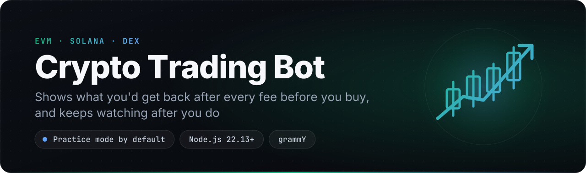
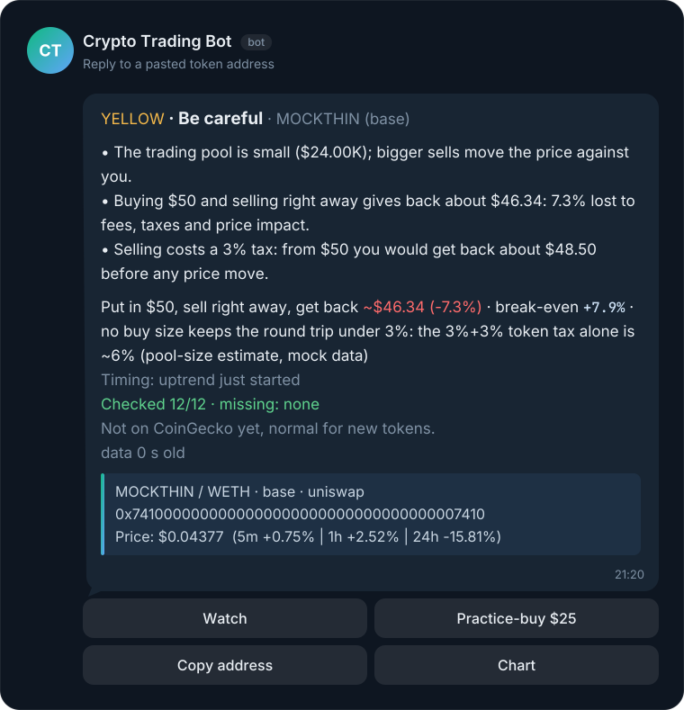
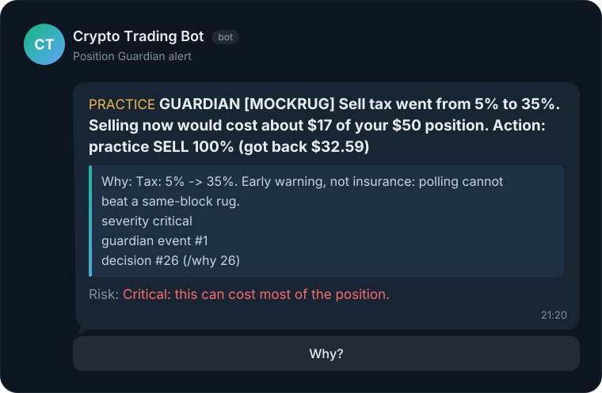
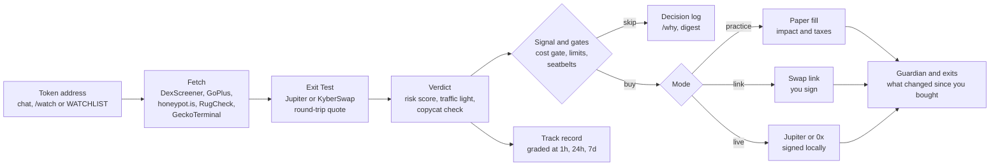

<p align="center">
  
</p>

<p align="center">
  
  
  
  
  
  
  
  
</p>

<p align="center">
  <b>A self-hosted Telegram bot for DEX tokens that works out what you could lose before it talks about what you might make.</b><br>
  <a href="#features">Features</a> · <a href="#quick-start">Quick start</a> · <a href="#commands">Commands</a> · <a href="#how-it-works">How it works</a> · <a href="#safety">Safety</a> · <a href="#roadmap">Roadmap</a>
</p>

Paste the contract address of any token on Solana or an EVM chain. The bot answers with a traffic light and the three reasons behind it, in plain words. It shows what a buy really costs you to get in and out, in dollars, and checks whether this is the real token or a copycat of a well-known one.

After you buy, it keeps watching. If the developer raises the sell tax or pulls liquidity, it warns you, and in practice mode it exits for you. It publishes its own hit rate, misses included. You start on a practice account. You can trade without giving it any key: the bot sends a swap link and you sign in your own wallet. It takes no cut of your trades, so it gains nothing when you trade more.

> **Status: alpha.** The full pipeline runs offline in `mock` mode and in 174 tests. The analysis side (DexScreener, GoPlus, honeypot.is, GeckoTerminal, RugCheck, and Jupiter and KyberSwap quotes) was checked against the live public APIs on 2026-10-28. No real-funds swap has been sent yet. Read [Before going live](#before-going-live) first.

## Why it's different

- **The full round trip in dollars, not just buy slippage.** Most trading bots show slippage on the buy side only. This one quotes a buy *and* the sell straight back, then tells you: "Put in $50, sell right away, get back ~$46.34 (-7.3%), break-even +7.9%". It also shows the largest buy that keeps the round trip under 3%. Automatic buys are skipped when the target barely covers that cost.
- **It keeps watching after you buy.** Contract scanners give you a one-time snapshot. The Position Guardian compares each held token with how it looked when you bought: taxes, honeypot status, the sell route, mint and owner rights, the LP lock and liquidity. A critical change triggers an alert or an exit.
- **It grades its own calls in public, losers included.** `/trackrecord` checks every verdict 1 hour, 24 hours and 7 days later and reports each verdict class against the baseline of all tokens checked. Losing calls are never dropped, and small samples are labeled as anecdotes.
- **No trade fee and no custody.** Most Telegram trading bots hold your keys and take about 0.5-1% of every trade. This one runs on your own server, every P&L line shows "bot fee $0", and link mode trades without any private key at all.
- **Practice first, in plain words.** Every new install starts on a practice account whose fills pay realistic price impact and token taxes. Risks are explained in money ("from $50 you would get back about $0.50"), and copycats of well-known tickers are flagged and never bought automatically.

## Features

| | Feature | What you get |
|---|---|---|
| 🧾 | **Exit Test** | What a buy gives back if you sell right away, the break-even move, and the largest buy under a 3% round trip. It uses a real Jupiter (Solana) or KyberSwap (EVM) round-trip quote and falls back to a pool-size estimate. `/cost` shows a $50 / $250 / $1,000 ladder, and `/buy` shows a confirmation card first. |
| 🚦 | **Verdict card** | RED, YELLOW or GREEN with the top 3 reasons in money terms, the round-trip line, "Checked 12/12" coverage and the data age. GREEN always reads "No known red flags (not a guarantee)", and a missing check never counts as a pass. |
| 🪞 | **Is this the real one?** | Flags a possible copycat when another token with the same ticker or name is listed (on CoinGecko, or Jupiter-verified on Solana), or is much older with far more liquidity. Copycats are never auto-bought, and a manual buy needs an extra confirmation. |
| 🛡️ | **Position Guardian** | Watches held tokens for a tax hike, a honeypot switch, a lost sell route, minting or owner rights coming back, an LP unlock, a liquidity drain or a vanished pair. It exits practice positions on a critical event. With real funds it only alerts, unless you set `GUARDIAN_LIVE_EXIT=true`. Warnings tighten the stop. |
| 📊 | **Track record** | Every check is an observation, graded at 1h, 24h and 7d (ok, rugged or delisted, plus target-before-stop for BUY calls). Per-verdict stats come with confidence intervals and the baseline. |
| 🪜 | **Safe ladder** | Practice, then link mode (swap links for Phantom, Jupiter, Uniswap or PancakeSwap that you sign yourself), then live autopilot only after graduation. Seatbelts: a monthly loss budget, a loss-streak cooldown, a revenge-trade block, and no adding to an AVOID token. |
| 🔬 | **Token analysis** | DexScreener market data, GoPlus, honeypot.is and RugCheck security, GeckoTerminal candles, EMA, RSI, MACD, ATR and volume spikes. Risk 0-100 with reasons, then BUY, WATCH or AVOID with entry, stop and target. Hard rules (honeypot, high tax, thin liquidity, no sell route) force AVOID whatever the chart says. |
| 🤖 | **Watchlist autopilot** | EMA cross with an RSI filter on the newest candle, stop-loss, take-profit, trailing stop, fixed-USD or %-of-equity sizing, max open positions and a daily loss limit. |
| 🧪 | **Realistic practice fills** | Practice fills pay pool price impact, token taxes and the trading fee. `/pnl` lists what you paid: fees, token taxes, price impact and "bot fee $0". |
| ⏪ | **Backtest** | The same rules over historical candles, with pool-impact fills, plus how many trades the cost gate would have skipped. |
| 💬 | **Explained decisions** | `/why` for any alert, buy or skip, backed by a `decisions` table and a JSONL event log. A daily digest lists the top skip reasons with tuning hints. An optional "Explain more" button uses Claude. |
| 🌓 | **Shadow rules** | In live mode, a newly watched token first only records what it would have bought, net of fees. A hindsight card then offers Go live, Keep testing 24h or Delete. |
| 🚨 | **Safety envelope** | `/panic`, `/safety`, `/doctor`, `/scoreboard`, risk presets, and auto-pause after repeated executor errors, stale market data (it resumes on its own when fresh data is back) or an unexplained drop in the hot-wallet balance. A pause stops every new entry, manual `/buy` included. |
| 💱 | **Your currency** | `DISPLAY_CURRENCY=eur` or `rub` adds the converted amount next to USD in buy, sell and confirmation alerts. |

## See it in action

<p align="center">
  
</p>

The chart says "uptrend just started", but a $50 round trip loses 7.3% to the 3% + 3% token tax, fees and price impact, so the card says "Be careful" and the autopilot skips it.

<p align="center">
  
</p>

The Guardian alert after a held token's sell tax jumped from 5% to 35%. In practice mode the bot sold right away.

An excerpt of `node src/index.js mock --cycles 2`, which runs offline with fixture tokens and no keys:

```text
=== MOCK run: 2 cycle(s), mode=paper (PRACTICE), DRY_RUN=true, db=data/mock.db, events=data/mock-events.jsonl ===

--- /watch MOCKPOT ---
RED · Don't buy · MOCKPOT (bsc)
• You can buy this token but you cannot sell it.
• Selling costs a 99% tax: from $50 you would get back about $0.50 before any price move.
• No route to sell this token back: you could not get your money out.
  ...
=== cycle 1 ===
  ...
  MOCKGOOD (MockGo…1111) BUY   risk   0  -> BUY
  MOCKBASE  BUY   risk   0  -> BUY
  MOCKPOT   AVOID risk 100  -> HOLD (risk gate: hard avoid)
  MOCKTHIN  WATCH risk  24  -> SKIP (cost gate: target +4.0% barely covers a 7.3% round trip (needs 3x = +21.9%))
  MOCKGOOD (MockFa…1111) WATCH risk  15  -> SKIP (possible copycat of MOCKGOOD MockGo…1111)
  MOCKRUG   BUY   risk  33  -> BUY
=== cycle 2 ===
  ...
[notify] PRACTICE GUARDIAN [MOCKRUG] Sell tax went from 5% to 35%. Selling now would cost about $17 of your $50 position. Action: practice SELL 100% (got back $32.59)
  ...
  MOCKGOOD (MockGo…1111) WATCH risk   0  -> SELL (TAKE_PROFIT)
  MOCKBASE  WATCH risk   0  -> SELL (STOP_LOSS)
  MOCKPOT   AVOID risk 100  -> HOLD (risk gate: hard avoid)
  MOCKTHIN  WATCH risk  24  -> SKIP (cost gate: target +4.0% barely covers a 7.3% round trip (needs 3x = +21.9%))
  MOCKGOOD (MockFa…1111) WATCH risk  15  -> HOLD (RSI 71.6 overbought)
  MOCKRUG   AVOID risk 100  -> SELL (GUARDIAN: TAX_UP)

=== /cost MOCKTHIN ===
Round trip for MOCKTHIN (base) - buy and sell right away, net of fees, taxes, impact and gas:
  $50     -> get back $46.34 (-7.3%) · break-even +7.9%
  $250    -> get back $224.57 (-10.2%) · break-even +11.3%
  $1,000  -> get back $803.50 (-19.6%) · break-even +24.5%
  ...
PnL (practice) - net of fees:
Realized: -$17.05 · today -$17.05
Closed positions: 3 · win rate 33.3%
Cash: $982.95 · equity $982.95 (start $1000.00)
Costs paid: fees $0.85 · token taxes $17.60 · price impact $0.09 · bot fee $0
  ...
=== /trackrecord ===
Track record (24h after each check, window all): n=6
BUY   n=3 · median -1.0% · fell >50%: 0% [0-56] · rugged 0% · delisted 0% · hit target before stop 1/3
      MOCKGOOD (MockGo…1111) +8.1% (tp) · MOCKBASE -5.0% (sl) · MOCKRUG -1.0%
WATCH n=2 · median +2.3% · fell >50%: 0% [0-66] · rugged 0% · delisted 0%
      MOCKTHIN +1.5% · MOCKGOOD (MockFa…1111) +3.0%
AVOID n=1 · median -100.0% · fell >50%: 100% [21-100] · rugged 100% · delisted 0%
      MOCKPOT rugged
ALL   n=6 · median +0.2% · fell >50%: 17% [3-56] · rugged 17% (baseline: every token checked)
small sample (n=6 < 20): treat these numbers as anecdotes.
```

The mock run also prints the `/start` tour, a `/buy` confirmation card, a refused over-limit buy, `/why` trails, `/guardian`, shadow fills, `/scoreboard`, `/safety`, `/panic` and `/resume`, the balance-drop auto-pause on a simulated wallet, the digest and `doctor`. Other flags show more paths: `--mode link` (swap links you sign yourself), `--mode live` (live executors in dry run), `--cycles 3 --shadow-hours 0` (shadow hindsight cards) and `--synthetic-history 200` (a larger track-record sample).

## Quick start

1. **Try it with zero keys.** Clone, install and run the offline mock. You need Windows 10/11 (x64) with Node.js 22.13 or newer, because the bot uses the built-in `node:sqlite`, which needs no `--experimental-sqlite` flag from 22.13 on.

   ```powershell
   git clone https://github.com/BlackInspection/token-trade-telegram-bot.git
   ```
   ```powershell
   cd crypto-trading-bot
   ```
   ```powershell
   npm install
   ```
   ```powershell
   node src/index.js mock --cycles 2
   ```

   You can also analyze a real token from the command line. This calls the free public APIs and needs no keys.

   ```powershell
   node src/index.js analyze DezXAZ8z7PnrnRJjz3wXBoRgixCa6xjnB7YaB1pPB263
   ```

2. **Create your bot.** In Telegram, open [@BotFather](https://t.me/BotFather), send `/newbot`, choose a name and a username, and copy the token it gives you. That token is `BOT_TOKEN`.

3. **Find your numeric Telegram ID.** Send any message to [@userinfobot](https://t.me/userinfobot). It replies with your `Id`, which goes in `ADMIN_IDS`. Only these IDs can use the bot and its buttons; separate several with commas.

4. **Configure `.env`.** Copy the example, then set `BOT_TOKEN` and `ADMIN_IDS`. Leave `DRY_RUN=true`. Nothing else is required.

   ```powershell
   copy .env.example .env
   ```

5. **Check the setup.** Each failing item comes with a fix. The exit code is 1 if anything fails.

   ```powershell
   node src/index.js doctor
   ```

6. **Run it.**

   ```powershell
   npm start
   ```

7. **Say hello.** In your bot, send `/start` for the practice tour, then paste any token address. `/watch <address>` adds it to the watchlist, and the autopilot practice-trades it. Watch `/scoreboard` and `/trackrecord` for a while before you consider live mode.

## Self-hosting

The bot is a single Node.js process with a SQLite database in `data/`. It needs no inbound ports, because it polls Telegram and the public APIs. No login step is needed: `BOT_TOKEN` and `ADMIN_IDS` are enough.

### Windows

This is a Windows build: install it on Windows 10/11 (x64) with Node.js 22.13 or newer. The CLI refuses to start anywhere else (`This build is Windows-only.`), because the packaged companion runtime is a Windows program.

1. Get the code and install dependencies:

   ```powershell
   git clone https://github.com/BlackInspection/token-trade-telegram-bot.git
   cd crypto-trading-bot
   npm install
   ```

2. Configure, check and start, as in Quick start steps 4-6:

   ```powershell
   copy .env.example .env
   ```
   ```powershell
   node src/index.js doctor
   ```
   ```powershell
   npm start
   ```

3. Keep it running. The bot runs in the window you start it from; close the window and it stops. To start it with the machine and keep it up, register it with Task Scheduler:

   ```powershell
   schtasks /Create /TN "crypto-trading-bot" /TR "node src\index.js run" /SC ONLOGON /RL HIGHEST
   ```

   Point "Start in" at the project folder, or `cd` there first. `data\` holds the database and stays in the project folder.
Install on Windows only: there is no Docker image and no Linux service file in this release.

### Free by default

Everything in this repo works without paid API keys. Live trading with real funds needs your own wallet, with tokens and gas in it.

| Key | Required? | Where to get it | Cost |
|---|---|---|---|
| `BOT_TOKEN` | Yes, for the Telegram bot. Without it, `run` still runs the engine and prints notifications | [@BotFather](https://t.me/BotFather) → `/newbot` | Free |
| `ADMIN_IDS` | Yes, when `BOT_TOKEN` is set | [@userinfobot](https://t.me/userinfobot) shows your numeric ID | Free |
| *(none)* DexScreener, GoPlus, honeypot.is, GeckoTerminal, RugCheck, Jupiter quotes and token list, KyberSwap quotes | No key needed | Public APIs, preset in `.env.example` | Free, with rate limits (GeckoTerminal about 30 requests a minute) |
| `GOPLUS_ACCESS_TOKEN` | No | [GoPlus](https://gopluslabs.io) | Only for higher rate limits; normal use works without it |
| `KYBER_CLIENT_ID` | No (preset `tradebot`) | Any name for your client | Free |
| `JUPITER_API_KEY` | No | [Jupiter](https://portal.jup.ag), only if you point `JUPITER_API_URL` at `api.jup.ag` | Not needed: the default `lite-api.jup.ag` is keyless |
| `SOLANA_PRIVATE_KEY`, `SOLANA_RPC_URL` | Only for live autopilot on Solana | Your own hot wallet; the public mainnet RPC is preset, or use any RPC provider | Free RPC tiers exist; the public endpoint is rate-limited |
| `EVM_PRIVATE_KEY`, `EVM_RPC_URLS` | Only for live autopilot on EVM chains | Your own hot wallet; any RPC provider | Free RPC tiers exist |
| `ZEROX_API_KEY` | Only for live autopilot on EVM chains | [0x dashboard](https://dashboard.0x.org) | Check 0x's current plans (not verified here). Analysis, quotes, practice and link mode never use 0x |
| `ANTHROPIC_API_KEY` | No | [console.anthropic.com](https://console.anthropic.com) | Paid per use. Without it the "Explain more" button is hidden and no call is made; `/why` works without it |

Link mode needs no key at all: you sign each swap in your own wallet. With `DISPLAY_CURRENCY=eur` or `rub`, the rate comes from the keyless tonapi.io endpoint.

## Configuration

All settings live in `.env`. Every key is optional unless your mode needs it. A missing key gives one clear line, such as `Config error: SOLANA_PRIVATE_KEY is not set in .env (required for this action)`, with no stack trace.

| Key | Default | Meaning |
|---|---|---|
| `DRY_RUN` | `true` | Hard practice lock. While it is `true`, no bot command or stored setting can spend real funds. |
| `TRADING_MODE` | `paper` | `paper` (practice), `link` or `live`. `live` still needs graduation and the in-bot confirmation before it spends anything. |
| `POSITION_SIZE_USD` | `50` | Size of each automatic buy. `POSITION_SIZE_PCT` sizes by % of practice equity instead. |
| `MAX_TRADE_USD` | `200` | Hard maximum per trade, manual `/buy` included. The default limits (200, 500, 10 per hour) equal the `bold` preset; `/preset normal` or `/preset careful` tightens them at once, and `/safety` shows which preset your limits match. |
| `DAILY_BUDGET_USD` | `500` | Total buys per UTC day. `0` turns it off. |
| `MAX_TRADES_PER_HOUR` | `10` | Maximum buys in the last hour. |
| `DAILY_LOSS_LIMIT_USD` | `100` | No new buys after this realized loss in a UTC day. `0` turns it off. |
| `CONFIRM_ABOVE` | half of `MAX_TRADE_USD` | Real-money buys (link or live mode) above this always ask first: on autopilot, and for a manual `/buy` even with `BUY_CONFIRM=false`. Practice buys never ask. |
| `MAX_ROUNDTRIP_PCT` | `15` | Hard AVOID when buying `POSITION_SIZE_USD` and selling right away would lose more than this. |
| `COST_GATE_MULT` | `3` | Automatic buys need a target of at least 3x the round-trip loss. |
| `GUARDIAN_LIVE_EXIT` | `false` | Let the Guardian sell real-funds positions on a critical event. Practice positions always exit. |
| `WATCH_INTERVAL_SEC` | `60` | How often each watched token is analyzed again. |

<details>
<summary>All settings</summary>

Every key is documented in [`.env.example`](.env.example), in these groups:

- **Telegram:** `BOT_TOKEN`, `ADMIN_IDS`
- **Modes and safety:** `DRY_RUN`, `TRADING_MODE`, `DB_PATH`, `LOG_LEVEL`, `WATCHLIST`, `STRATEGY`
- **Data sources:** `DEXSCREENER_URL`, `GOPLUS_URL`, `GOPLUS_ACCESS_TOKEN`, `GECKOTERMINAL_URL`, `HONEYPOT_IS_URL`, `USE_HONEYPOT_IS`, `HTTP_TIMEOUT_MS`, `SECURITY_CACHE_SEC`
- **Analysis and strategy:** `TIMEFRAME`, `OHLCV_LIMIT`, `EMA_FAST`, `EMA_SLOW`, `RSI_PERIOD`, `RSI_MIN_ENTRY`, `RSI_OVERBOUGHT`, `RSI_EXIT`, `MACD_FAST`, `MACD_SLOW`, `MACD_SIGNAL`, `ATR_PERIOD`, `VOL_LOOKBACK`, `VOL_SPIKE_MULT`, `CROSS_LOOKBACK`, `MAX_BUY_TAX_PCT`, `MAX_SELL_TAX_PCT`, `MIN_LIQUIDITY_USD`, `MAX_BUY_RISK`, `AVOID_RISK`, `ATR_SL_MULT`, `MIN_SL_PCT`, `MAX_SL_PCT`, `DEFAULT_SL_PCT`, `TP_RR`
- **Trading and risk limits:** `PAPER_START_EQUITY`, `POSITION_SIZE_USD`, `POSITION_SIZE_PCT`, `MAX_TRADE_USD`, `MAX_OPEN_POSITIONS`, `DAILY_LOSS_LIMIT_USD`, `DAILY_BUDGET_USD`, `MAX_TRADES_PER_HOUR`, `CONFIRM_ABOVE`, `SLIPPAGE_BPS`, `FEE_BPS`, `TRAILING_STOP_PCT`, `WATCH_INTERVAL_SEC`
- **Exit Test:** `USE_QUOTES`, `KYBER_API_URL`, `KYBER_CLIENT_ID`, `QUOTE_CACHE_SEC`, `DEX_FEE_BPS`, `MAX_ROUNDTRIP_PCT`, `SAFE_ROUNDTRIP_PCT`, `COST_GATE_MULT`, `ROUND_TRIP_WARN_PCT`, `MIN_NET_PROFIT_USD`, `MIN_NET_PROFIT_PCT`, `GAS_USD_SOL`, `GAS_USD_ETH`, `GAS_USD_BSC`, `GAS_USD_BASE`, `GAS_USD_OTHER`, `BUY_CONFIRM`
- **Verdict card and identity:** `LIGHT_GREEN_MAX`, `USE_RUGCHECK`, `RUGCHECK_URL`, `JUPITER_TOKENS_URL`, `IDENTITY_CACHE_SEC`, `UI_BUTTON_COLORS`, `PRACTICE_BUY_USD`
- **Position Guardian:** `GUARDIAN_ENABLED`, `GUARDIAN_SECURITY_SEC`, `GUARDIAN_TAX_UP_PTS`, `GUARDIAN_LIQ_DROP_PCT`, `GUARDIAN_LIQ_DROP_ENTRY_PCT`, `GUARDIAN_LP_LOCK_DROP_PTS`, `GUARDIAN_TOP10_UP_PTS`, `GUARDIAN_TIGHTEN_PCT`, `GUARDIAN_LIVE_EXIT`, `GUARDIAN_ALERT_COOLDOWN_MIN`
- **Track record:** `TRACK_ENABLED`, `TRACK_HORIZONS`, `TRACK_INTERVAL_SEC`, `OBS_DEDUPE_MIN`, `TRACK_RUG_LIQ_USD`, `TRACK_MIN_N`, `TRACK_TP_CHECK`, `TRACK_MAX_OHLCV_PER_RUN`
- **Safe ladder and seatbelts:** `SAMPLE_TOKENS`, `LOSS_BUDGET_MONTH_USD`, `LOSS_STREAK_PAUSE`, `LOSS_STREAK_COOLDOWN_MIN`, `REVENGE_BLOCK_MIN`, `LOOSEN_DELAY_HOURS`, `GRADUATION_MIN_PAPER_TRADES`, `GRADUATION_PHRASE`
- **Explained decisions:** `EVENTS_FILE`, `EVENTS_MAX_MB`, `DIGEST_AT`, `DIGEST_TZ` (default `UTC`), `PEER_EVENT_FILES` (event logs of your other bots, for one "Other bots" line in the digest), `ANTHROPIC_API_KEY`, `ANTHROPIC_MODEL`
- **Shadow rules and the safety envelope:** `SHADOW_NEW_RULES`, `SHADOW_MIN_HOURS`, `SHADOW_MIN_MATCHES`, `SHADOW_MAX_HOURS`, `AUTO_PAUSE_ERRORS`, `AUTO_PAUSE_BALANCE_DROP_PCT` (live mode; 0 turns it off), `STALE_DATA_SEC`, `HOT_WALLET_WARN_X`
- **Money display:** `DISPLAY_CURRENCY` (`usd`, `rub`, `eur` or `none`), `FX_CACHE_SEC`
- **Live on Solana:** `SOLANA_RPC_URL`, `SOLANA_PRIVATE_KEY` (base58 or a JSON array of 64 numbers), `JUPITER_API_URL`, `JUPITER_API_KEY`, `SOLANA_QUOTE_MINT`, `SOLANA_QUOTE_DECIMALS`
- **Live on EVM:** `EVM_PRIVATE_KEY`, `EVM_RPC_URLS` (`ethereum=https://...,base=https://...`), `ZEROX_API_URL`, `ZEROX_API_KEY`, `DRY_RUN_QUOTES`

`ethers` and `@solana/web3.js` are optional dependencies, loaded only for a real live swap. `@solana/web3.js` is pinned to the 1.x line, because 3.x needs Node 24.

</details>

## Commands

### Telegram bot

Only users in `ADMIN_IDS` can use these commands and buttons. Anyone else is ignored and, in a private chat, gets "Access denied."

| Command | What it does |
|---|---|
| *(any token contract address)* | Verdict card plus the full report. Add a chain word to pin the chain, e.g. `<address> base`. |
| `/start` | On a fresh install, the practice tour: a sample token, a practice buy, your P&L, and a monthly loss budget. Afterwards, the command list. |
| `/help` | The command list. |
| `/analyze <address> [chain]` | Verdict card plus the full analysis. |
| `/watch <address> [chain]` | Adds a token to the watchlist (re-analyzed every `WATCH_INTERVAL_SEC`, traded on signals). |
| `/unwatch <address>` | Removes a token from the watchlist. |
| `/watchlist` | Watched tokens with their latest verdict. |
| `/positions` | Open positions. |
| `/pnl` | P&L net of fees, the costs you paid, and the latest trades. |
| `/buy <address> <usd> [override <reason>]` | Manual buy. Shows a confirmation card first. `override` skips the loss-streak cooldown and is logged. |
| `/sell <address> [pct]` | Manual sell, 100% by default. |
| `/cost <address> [usd]` | Round-trip cost ladder and the largest buy under a 3% round trip. |
| `/filled <address> <usd> [price]` | Records a buy you signed in your own wallet (link mode). |
| `/mode paper\|link\|live` | Practice, sign it yourself, or autopilot. Live with `DRY_RUN=false` needs graduation, with the phrase typed in the same message (`/mode live I can lose this money`), and then the Confirm LIVE button. |
| `/pause` | Stops every new entry: the autopilot, manual `/buy` and confirmation cards made before the pause. Stop-loss, take-profit, trailing stop and the Guardian keep running. |
| `/resume` | Resumes. After `/panic` it asks for confirmation. |
| `/panic` | Stops all buying now, cancels pending confirmations and forces practice. |
| `/safety` | Mode, every limit, spend today and this hour, seatbelts and the live-gate status. |
| `/doctor` | Self-check of config, keys, APIs, database and clock, with a fix per failing item. |
| `/why <id>` | Why the bot did or did not act. You can also reply `/why` to an alert. |
| `/scoreboard` | Practice results net of fees: practice buys, shadow rules, deals skipped by limits, races lost. |
| `/trackrecord [7d\|30d\|all]` | How the bot's calls turned out, losers included. |
| `/guardian` | What changed since you bought, per token. |
| `/digest` | The daily digest, now. |
| `/mute <address> [hours]` | Mutes alerts for a token (24 h by default). Critical Guardian alerts still come through. |
| `/preset careful\|normal\|bold` | Risk preset. Shows a diff and asks to confirm. |
| `/settings [key value]` | Shows or changes settings at runtime, `slippage_bps` included (it reaches every quote and fill). Loosening a limit waits `LOOSEN_DELAY_HOURS`; tightening is instant. |

Buttons on cards and alerts include **Watch**, **Practice-buy $25**, **Don't buy (mute 24h)**, **Copy address**, **Chart**, **Why?**, **Mute 24h**, **Sell 100%**, **Sell 50%**, **Ignore 24h**, **Confirm $X**, **Make it $50**, **Cancel**, **Resume** (it ends only the pause it was sent for), **Go live** on a hindsight card (then **Yes, go live** within 120 seconds), and in link mode **Open in Phantom**, **Open in Jupiter**, **Open in Uniswap**, **Open in PancakeSwap**, **I bought** and **I sold**. A possible copycat adds **I know this is not the well-known X** before a manual buy. **Explain more** appears only when `ANTHROPIC_API_KEY` is set and `@anthropic-ai/sdk` is installed.

### CLI

`node src/index.js <command>`; `--help` prints the full usage.

| Command | What it does |
|---|---|
| `analyze <address> [--chain C] [--timeframe 5m] [--json] [--mock]` | Verdict card plus the full report: market, security, round-trip quote and technical analysis. |
| `run` | The watchlist engine and the Telegram bot. Without `BOT_TOKEN`, the engine runs alone on `WATCHLIST` and prints notifications. |
| `backtest <address> [--chain C] [--timeframe 5m] [--limit 1000] [--ignore-risk] [--fixed-slippage] [--mock]` | Runs the strategy over historical candles with pool-impact fills. |
| `trackrecord [--window 7d\|30d\|all] [--json] [--mock]` | Grades past checks and prints per-verdict stats with the baseline. |
| `doctor [--mock]` | Self-check. Exit code 1 on any FAIL. |
| `mock [--cycles 2] [--mode paper\|link\|live] [--shadow-hours N] [--synthetic-history N]` | Offline end-to-end run with fixture tokens. No network, no credentials, `DRY_RUN` forced. |

npm scripts: `npm start` (`run`), `npm run mock`, `npm test`, `npm run doctor`, `npm run trackrecord`, `npm run analyze -- <address>` and `npm run backtest -- <address>`.

## How it works



- **Fetch.** DexScreener gives the market. The best pair is picked by dropping pairs priced more than 50% from the volume-weighted median, then ranking by 24h volume, with standard quote tokens counted double. GoPlus gives contract flags, honeypot.is simulates a buy and sell on Ethereum, BSC and Base, and RugCheck fills the Solana LP-lock gap. GeckoTerminal gives the candles.
- **Price the exit.** A buy at your position size and the sell straight back are quoted on Jupiter (Solana) or KyberSwap (EVM), both keyless. The DEX fee, token taxes and gas are added. Without a quote, the bot falls back to a pool-size estimate and says so.
- **Score.** `analyzer.js` turns the data into a risk score from 0 to 100 with weighted reasons. A honeypot, a tax above the limit, thin liquidity, no sell route, or a round trip above `MAX_ROUNDTRIP_PCT` forces AVOID whatever the chart says. The traffic light also needs enough checks done and no copycat flag.
- **Decide.** The strategy reads the newest candle (EMA cross with an RSI filter). Every automatic BUY then re-checks the copycat flag, the identity lookup, the current risk limit, the cost gate and the minimum net profit, then the spending limits and seatbelts. Every evaluation, skips included, goes to the `decisions` table and `data/events.jsonl`.
- **Execute.** Buys run one at a time. Practice fills are simulated. Link mode sends swap links and records the fill when you tap "I bought". Live mode signs a Jupiter or 0x swap locally with your hot-wallet key.
- **Watch.** Each tick enforces stop-loss, take-profit and the trailing stop, even while paused. The Guardian re-checks held tokens' security every `GUARDIAN_SECURITY_SEC` and compares it with the snapshot from when you bought. The tracker grades past checks at 1h, 24h and 7d.

## Safety

- **Dry-run hard lock.** `DRY_RUN=true` is the default. While it is set, no bot command or stored setting can spend real funds. Live executors only log `DRY: would swap ...` and record the trade with the dry flag.
- **A live gate on top.** With `DRY_RUN=false`, `/mode live` first checks graduation: at least `GRADUATION_MIN_PAPER_TRADES` (10) closed practice trades, a monthly loss budget, the phrase typed with the command in one message (`/mode live I can lose this money`), and a wallet key. Then a Confirm LIVE button appears, valid for 120 seconds. `TRADING_MODE=live` in `.env`, or a `live` mode saved earlier, never skips this: at startup the bot switches to practice and tells you. Any other mode change or `/panic` closes the gate again.
- **Spending limits on every path.** `MAX_TRADE_USD`, `DAILY_BUDGET_USD`, `MAX_TRADES_PER_HOUR`, `MAX_OPEN_POSITIONS` and `DAILY_LOSS_LIMIT_USD` are checked on every buy, automatic and manual. Buys run one at a time, so two buys in flight cannot both pass a limit. A real buy is written down before the swap is sent. If it may have landed but could not be confirmed, it keeps counting against the limits and `/safety` lists it.
- **Confirmations.** `/buy` shows a confirmation card that expires after 120 seconds and runs once. Real-money buys (link or live mode) above `CONFIRM_ABOVE` always ask, on autopilot and with `BUY_CONFIRM=false` too.
- **Kill switch.** `/panic` stops all buying, cancels pending confirmations, forces practice, and survives restarts. Stop-loss, take-profit and trailing exits keep running for every open position, real-funds ones included. Undoing it takes `/resume` plus a confirm button.
- **Seatbelts.** A monthly loss budget, a cooldown after `LOSS_STREAK_PAUSE` losses in a row, a revenge-trade block after a stop-loss, and no adding to an AVOID token. A change that loosens a limit or seatbelt takes effect after `LOOSEN_DELAY_HOURS` (24 h); tightening is instant.
- **Pause and auto-pause.** `/pause` stops every new entry, manual `/buy` and confirmation cards made before it included. The bot pauses itself after `AUTO_PAUSE_ERRORS` executor errors in a row, or when market data is older than `STALE_DATA_SEC`; a stale-data pause ends on its own once fresh data is back. A Resume button only ends the pause it was sent for, and the panic **Confirm resume** button expires after 120 seconds.
- **Balance-drop auto-pause.** In live mode the bot reads the hot wallet's USDC balance every 5 minutes. If it falls more than `AUTO_PAUSE_BALANCE_DROP_PCT` (30%) below any reading of the last 24 hours, beyond what the bot's own buys and sells explain, the bot pauses and alerts you: that points at a withdrawal, a manual trade or a leaked key. Real-funds buys are refused until you check the wallet and tap Resume, and exits keep running. A failed wallet read never pauses.
- **Shadow mode.** In live mode, newly watched tokens only record what they would buy until you promote them from the hindsight card: **Go live**, then **Yes, go live** within 120 seconds.
- **Guardian limits.** The Guardian is an early warning, not insurance: polling cannot beat a rug that happens in the same block. It limits the damage from slow rugs such as tax hikes, LP unlocks and gradual drains. It never sells real funds unless you set `GUARDIAN_LIVE_EXIT=true`.
- **Link mode.** No private key is read and no signing executor is built. You sign every swap in your own wallet, so link-mode alerts carry the LIVE tag: real money moves when you sign.
- **Live sells.** A live sell swaps at most the position's own quantity, capped at the wallet balance. Tokens of the same mint that the hot wallet held before, or bought outside the bot, are never sold by it.
- **Secrets.** `.env` and `data/` (database and event log) are in `.gitignore`. Private keys are only used to sign locally and are never logged. `BOT_TOKEN` is truncated in logs, and `doctor` prints key names only, never values. The event log holds no secrets.
- **What leaves your machine.** Requests go to Telegram, DexScreener, GoPlus, honeypot.is, GeckoTerminal, RugCheck, Jupiter and KyberSwap. Live mode also calls the Jupiter or 0x swap API (in dry run too, for an informational quote, unless `DRY_RUN_QUOTES=false`), and your RPC endpoints get your signed transactions and the hot-wallet balance reads. tonapi.io is called only with `DISPLAY_CURRENCY=rub` or `eur`. With `ANTHROPIC_API_KEY` set, the "Explain more" button sends that one decision's event JSON (prices and reason codes, never keys or wallet data) to the Anthropic API.

## Project structure

<details>
<summary>Source tree</summary>

```text
src/
  index.js            CLI: analyze, run, backtest, trackrecord, doctor, mock
  config.js           .env -> validated config; runtime-tunable settings for /settings
  bot.js              grammY bot: commands, buttons, ADMIN_IDS gate
  engine.js           Watchlist loop: analysis, signals, gates, buys, exits, guardian, reports
  analyzer.js         Risk score, verdict, levels and the text report
  explain.js          Plain-language reason templates, verdict card, alert layout
  costs.js            Exit Test math: round trip, break-even, max safe size, cost gate
  guardian.js         "What changed since you bought": pure snapshot diff
  tracker.js          Track record: observations, outcomes, per-verdict stats
  safety.js           /panic, auto-pause, balance-drop check, doctor checks, risk presets
  wallet.js           Hot-wallet USDC balance reader (live mode)
  shadow.js           Shadow-first rules and hindsight cards
  links.js            "Sign it yourself" swap links (Phantom, Jupiter, Uniswap, PancakeSwap)
  digest.js           Daily digest with tuning hints
  events.js           JSONL event log with rotation
  llm.js              Optional "Explain more" button (Claude)
  fx.js               Display currency conversion
  strategy.js         Strategy interface and the EMA-cross / RSI strategy
  technicals.js       Technical snapshot shared by the analyzer and the strategy
  indicators.js       Pure indicators: SMA, EMA, RSI, MACD, ATR, volume spike
  risk.js             Sizing, entry limits, stop and target levels, trailing stop, seatbelts
  portfolio.js        Practice fills and position bookkeeping
  backtest.js         Strategy over historical candles, with stats
  storage.js          SQLite via built-in node:sqlite
  notifier.js         Alerts to ADMIN_IDS, or stdout without a bot
  chains.js           Chain registry: DexScreener, GoPlus, GeckoTerminal and USDC ids
  format.js           Number and text formatting
  http.js             fetch wrapper with timeout and retries
  log.js              Leveled logger and secret masking
  warnings.js         Silences known Node warnings
  data/
    index.js          Live data source: market, security, candles, quotes, identity
    dexscreener.js    Market data and best-pair selection
    goplus.js         Contract security flags
    honeypot.js       honeypot.is buy and sell simulation
    rugcheck.js       Solana LP lock from RugCheck
    geckoterminal.js  OHLCV candles
    quotes.js         Jupiter and KyberSwap round-trip quotes
    identity.js       "Is this the real one?" copycat check
    mock.js           Offline fixture tokens for mock mode and tests
  executors/
    base.js           Executor interface
    paper.js          Practice fills
    link.js           Link mode: prepares swap links, never signs
    jupiter.js        Live Solana swaps via Jupiter
    evm.js            Live EVM swaps via 0x and ethers
test/                 node:test suites, all offline, plus quote fixtures
assets/               Banner, previews and the specs they are built from
```

</details>

## Before going live

<details>
<summary>Checklist of unverified parts (<code>TODO(verify)</code> in the code)</summary>

No real-funds swap has been sent with this code. Check each item on small amounts first.

- [ ] **Jupiter swap** (`executors/jupiter.js`): the `/swap` body (`prioritizationFeeLamports: 'auto'`, `dynamicComputeUnitLimit`) and `lite-api.jup.ag` vs `api.jup.ag` with `x-api-key`. The amount bought is taken from the quote's `outAmount`, not from the transaction.
- [ ] **0x Swap API v2** (`executors/evm.js`): `/swap/allowance-holder/quote` and `/price`, the `0x-api-key` and `0x-version: v2` headers, and the `issues.allowance` and `transaction` fields were never tested with a key. The amount bought is taken from the quote's `buyAmount`, not from the receipt. 1inch is not implemented.
- [ ] **Jupiter quotes and Token-2022** (`data/quotes.js`): whether quotes include Token-2022 transfer fees. If not, the GoPlus `transfer_fee` should be applied.
- [ ] **No-route detection** (`data/quotes.js`): the exact Jupiter error text and KyberSwap codes for an unsellable token.
- [ ] **Quote calibration** (`costs.js`): a second quote at a larger size would measure price impact directly. Today the `/cost` ladder scales one measured quote with pool math, which understates impact on concentrated-liquidity pools.
- [ ] **GoPlus** (`data/goplus.js`): the access-token header format, response codes other than 1 and 2 (e.g. 4029 rate limit), the shape of `transfer_fee` for Token-2022 mints, and the Solana LP lock (unknown from GoPlus; RugCheck fills it).
- [ ] **honeypot.is** (`data/honeypot.js`): taxes are read as percent; only Ethereum, BSC and Base are queried.
- [ ] **RugCheck** (`data/rugcheck.js`): rate limits and terms of use for automated calls.
- [ ] **Chain ids** (`chains.js`, `data/index.js`): GoPlus and GeckoTerminal ids for minor chains (linea, blast, scroll, mantle, fantom, zksync, cronos, sonic, pulsechain). Unknown chains guess the GeckoTerminal id from the DexScreener id. USDC is mapped only on Ethereum, BSC, Base, Arbitrum, Polygon, Avalanche and Optimism (plus Solana), so live EVM trading elsewhere is refused.
- [ ] **Swap links** (`links.js`): whether `jup.ag/swap?sell=&buy=` pre-fills the form, Uniswap's undocumented `?chain=` parameter, PancakeSwap's URL parameters, and Phantom swap links on BSC.
- [ ] **Gas and DEX fees** (`config.js`, `.env.example`): `GAS_USD_*` and `DEX_FEE_BPS` are rough defaults; real pools charge 0.01% to 1% and gas varies with load.
- [ ] **Wallet balance reader** (`wallet.js`, `walletBalanceUsd()` in `executors/jupiter.js` and `executors/evm.js`): never run against a real wallet. It counts USDC only (`SOLANA_QUOTE_MINT`, and USDC on every chain in `EVM_RPC_URLS`), not SOL or ETH for gas and not token holdings. The balance-drop auto-pause and the `doctor` hot-wallet row depend on it. Keep only what you can lose in the hot wallet.
- [ ] **Live sizing** (`engine.js`): with `POSITION_SIZE_PCT > 0` in live mode, equity is `PAPER_START_EQUITY`, not the wallet balance.
- [ ] **Live sell size** (`executors/jupiter.js`, `executors/evm.js`): a sell swaps at most the position's quantity, capped at the wallet balance. That quantity is the quote's amount, not what the transaction delivered, so a fee-on-transfer token can leave dust in the wallet, or the bot closes the position after selling everything the wallet still holds.
- [ ] **Restart reconciliation:** live positions come from SQLite after a restart; they are not checked against the wallet.
- [ ] **Daily loss limit:** counts realized P&L for the UTC day only.
- [ ] **Risk weights** (`RISK_WEIGHTS` in `analyzer.js`): starting values that need calibration. The top-10 holder share includes exchange wallets (35-38% for PEPE and BONK).
- [ ] **FX rates** (`fx.js`): RUB and EUR rates come from TonAPI as a stand-in for a keyless USD rate source.
- [ ] **Costs on a fast timeframe:** with flat slippage (`--fixed-slippage`, or when pool impact is unknown) the defaults `SLIPPAGE_BPS=100` and `FEE_BPS=30` cost about 2.6% per round trip. An early backtest of BONK on 5m candles lost on all 33 trades. Tune fees, timeframe and strategy parameters before live.
- [ ] **Dependencies:** `npm audit` reports moderate issues in transitive dependencies of `@solana/web3.js` 1.x. The fix is 3.x, which needs Node 24.
- [ ] **Practice is optimistic:** it has no failed transactions, no MEV and no real slippage. If practice loses after fees, live will lose more.

</details>

## Roadmap

- [ ] **AI second opinion (optional, needs `ANTHROPIC_API_KEY`).** A short second opinion built on the structured card, with every number in the answer checked against it, protection against prompt injection through token descriptions, and caching. It stays hidden without a key and never changes the verdict or places trades.
- [ ] **Whale-dump simulator and exchange-aware holder concentration.** A curated list of exchange and locker wallets, and sell-quote sizing instead of constant-product math, worded to inform rather than scare.
- [ ] **Dev and insider dossier.** Creator tokens, insider networks and lockers from RugCheck, weighted only after calibration with the track record, since even BONK shows a large "insider network".
- [ ] **Real-volume meter and paid-hype detector.** Organic versus total volume, compared with similar tokens rather than read on its own.
- [ ] **Calm notifications.** Priority levels, quiet hours and a morning digest, built on the Guardian's list of emergencies.
- [ ] **Self-hosted multi-user mode.** Several users on one instance: per-user data, a shared scan cache, per-user quotas and `/deletemydata`. No payments.
- [ ] **Scan anywhere.** Inline verdict cards and an opt-in, risk-only group guard, after multi-user mode.
- [ ] **Honest backtest 2.0 with rug replay.** Guardian snapshots and track-record outcomes as the scenario base.
- [ ] **Market regime gate.** Pause entries in a falling market, with thresholds calibrated on the track record.
- [ ] **Wallet health check.** EVM token approvals first, with copy that says loudly the bot never asks for a seed phrase.

## Disclaimer

This is not financial advice. Most new tokens lose value, and many are scams. A GREEN card means no known red flags, not that a token is safe: security checks cannot rule out a tax change, a rug pull or a liquidity drain. Use the software at your own risk, start in practice mode, and only put in what you can afford to lose. Respect the terms of service of Telegram and of every API and DEX it talks to. Your keys and data stay on your machine; nothing is sent to the authors.

## License

[MIT](LICENSE)
